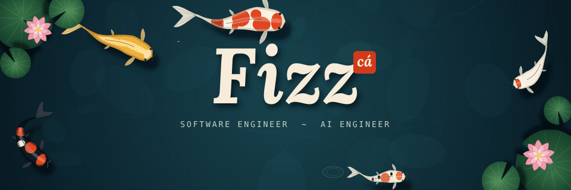
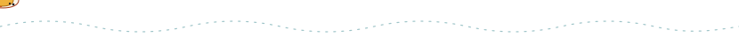

 

### *Bơi ngược dòng, rồi hóa rồng.*

Swim upstream, then become the dragon.

  

Hi, I'm **Fizz**, a software and AI engineer from Pleiku, Vietnam. 
I build full-stack web products and multi-agent systems.

## Software

<table>
  <tr>
    <td width="50%" valign="top">
      <h3><a href="https://github.com/Fizzisme/fiurozz-fe">Fiurozz</a></h3>
      
A portfolio and project showcase platform that tells the story behind the code: the architecture, the technical decisions and the engineering process.

      
<code>Next.js</code> <code>NestJS</code> <code>Go</code> <code>RabbitMQ</code> <code>PostgreSQL</code>

      
<a href="https://github.com/Fizzisme/fiurozz-fe">Frontend</a> · <a href="https://github.com/Fizzisme/fiurozz-be">Backend</a>

    </td>
    <td width="50%" valign="top">
      <h3><a href="https://github.com/minhphu05/finsights-frontend">Finsights</a></h3>
      
A Vietnamese finance website with a stock market board, company news, a watchlist and an AI chatbot. I work on the frontend and the chatbot experience.

      
<code>Next.js</code> <code>React</code> <code>TypeScript</code>

      
<a href="https://github.com/minhphu05/finsights-frontend">Frontend</a>

    </td>
  </tr>
</table>

## AI

<table>
  <tr>
    <td width="50%" valign="top">
      <h3><a href="https://github.com/kutin2005gl/BOA">BOA</a></h3>
      
A multi-agent system for phone retail operations. A coordinator plans the work, specialist agents carry it out, and a person approves each action before it runs.

      
<code>Go</code> <code>Python</code> <code>LangGraph</code> <code>FastAPI</code> <code>Next.js</code>

      
<a href="https://github.com/kutin2005gl/BOA">Repository</a> · Team project

    </td>
    <td width="50%" valign="top">
      <h3><a href="https://github.com/Fizzisme/catronaut">Catronaut</a></h3>
      
An agent harness that will turn a request like "build an e-commerce site" into a Next.js project running live in the browser. It asks, plans, writes and then verifies.

      
<code>Python</code> <code>FastAPI</code> <code>MCP</code> <code>vLLM</code>

      
<a href="https://github.com/Fizzisme/catronaut">Repository</a> · In planning

    </td>
  </tr>
</table>

## Stack

  

  Say hi on <a href="https://facebook.com/Fi.is.me.hello">Facebook</a>.

