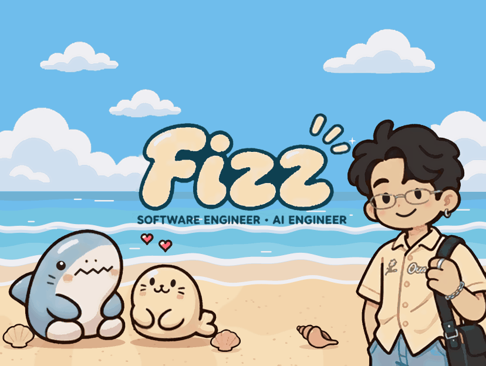
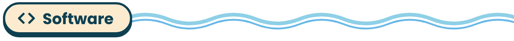
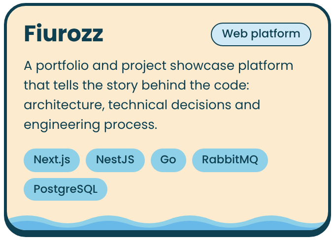
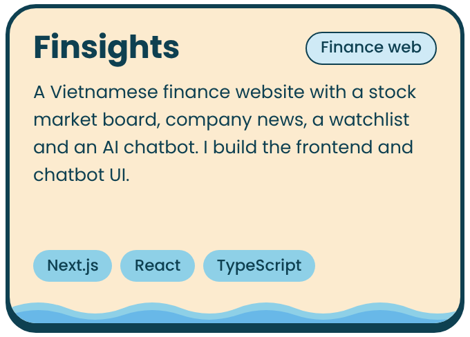
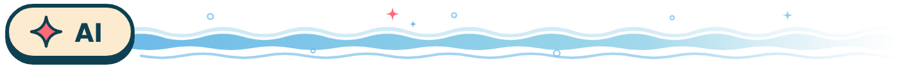
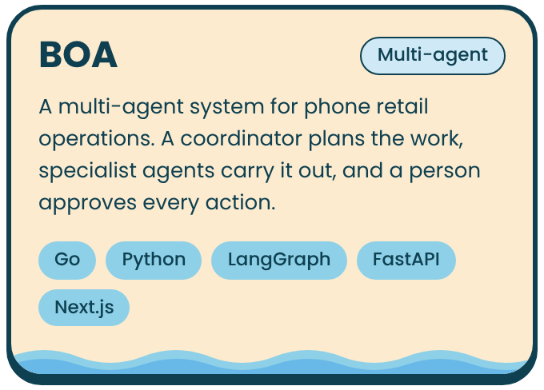
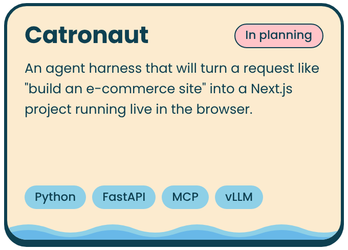
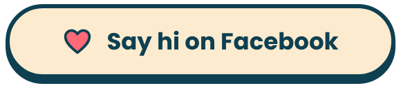

  

Hi, I'm **Fizz**, a software and AI engineer from Pleiku, Vietnam. 
I build full-stack web products and multi-agent systems.

<h3 align="center"></h3>

  
  

  Fiurozz: <a href="https://github.com/Fizzisme/fiurozz-fe">frontend</a> · <a href="https://github.com/Fizzisme/fiurozz-be">backend</a>

<h3 align="center"></h3>

  
  

<h3 align="center"></h3>

  

  

