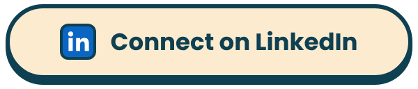

  Hi, I'm <b>Fizz</b>, a software and AI engineer from Vietnam. 
  I build production-grade software and agent systems, with a focus on reliability, scalability and observability.

<h3 align="center"></h3>

  
  

  Fiurozz: <a href="https://github.com/Fizzisme/fiurozz-fe">frontend</a> · <a href="https://github.com/Fizzisme/fiurozz-be">backend</a>

<h3 align="center"></h3>

  
  

<h3 align="center"></h3>

  
  
  
  
   
  
  
  
   
  
  
  
  
   
  
  
  
  

  
  

