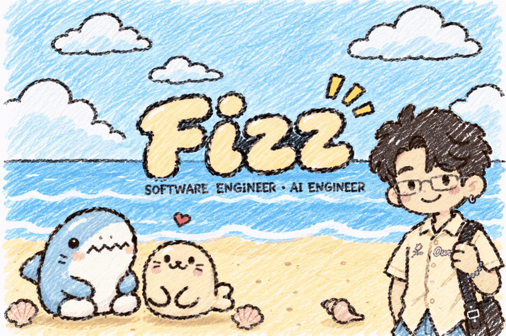

  Hi, I'm <b>Fizz</b>, a software and AI engineer from Vietnam. 
  I build production-grade software and agent systems, with a focus on reliability, scalability and observability.

<h3 align="center">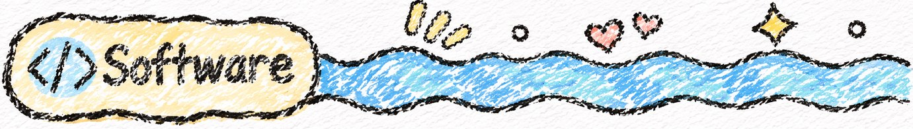</h3>

  <a href="https://github.com/23521155/cloud-e-commerce">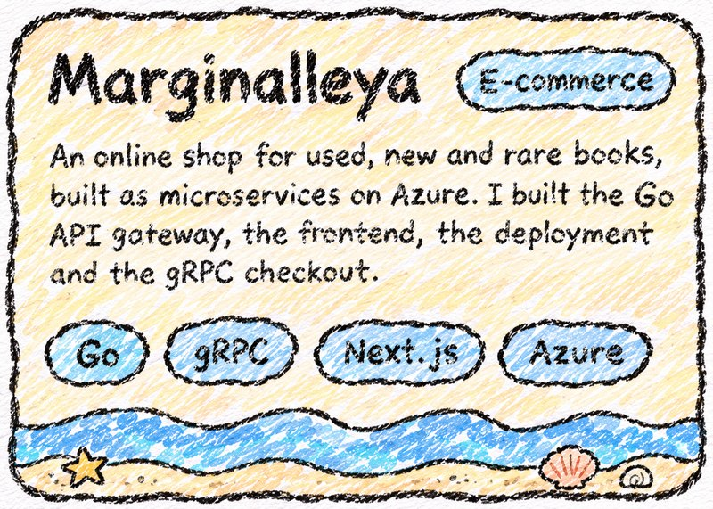</a>
  <a href="https://github.com/Fizzisme/fiurozz-be">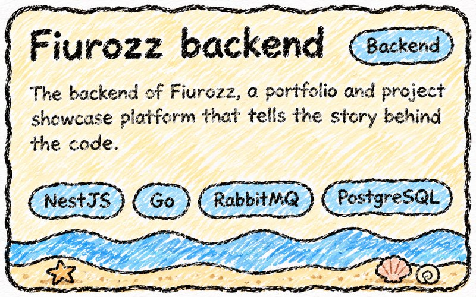</a>

  Marginalleya: <a href="https://demo.marginalleya.me/">live demo</a> · <a href="https://github.com/23521155/cloud-e-commerce">code</a> &nbsp;|&nbsp; Fiurozz: <a href="https://github.com/Fizzisme/fiurozz-fe">frontend</a> · <a href="https://github.com/Fizzisme/fiurozz-be">backend</a>

<h3 align="center">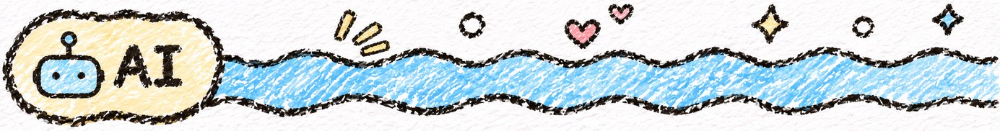</h3>

  <a href="https://github.com/kutin2005gl/BOA">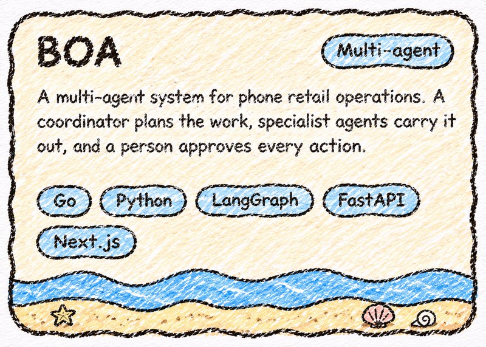</a>
  <a href="https://github.com/Fizzisme/finsights-ai-service">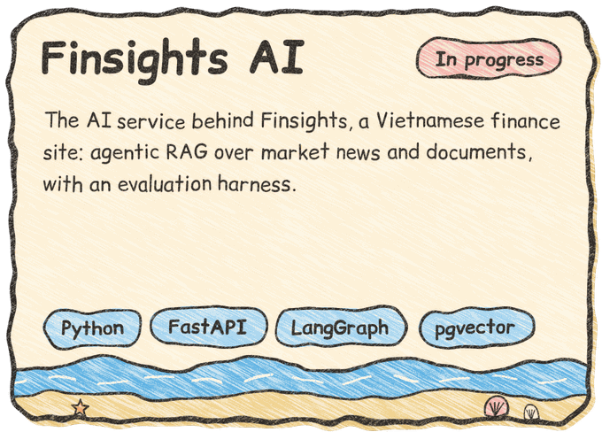</a>

  Finsights: <a href="https://finsights-frontend-gray.vercel.app/">live site</a> · <a href="https://github.com/Fizzisme/finsights-ai-service">AI service</a>

<h3 align="center">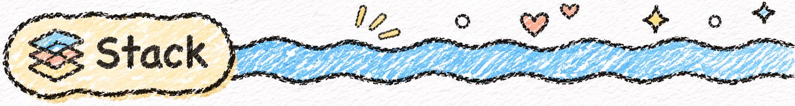</h3>

  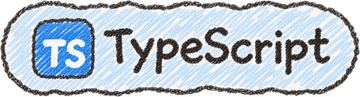
  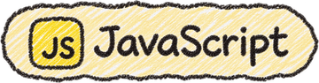
  
  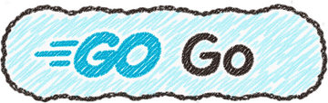
   
  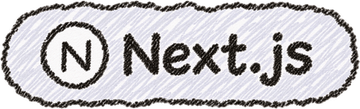
  
  
   
  
  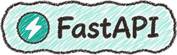
  
  
  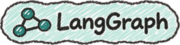
   
  
  
  
  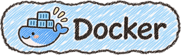

  
  

